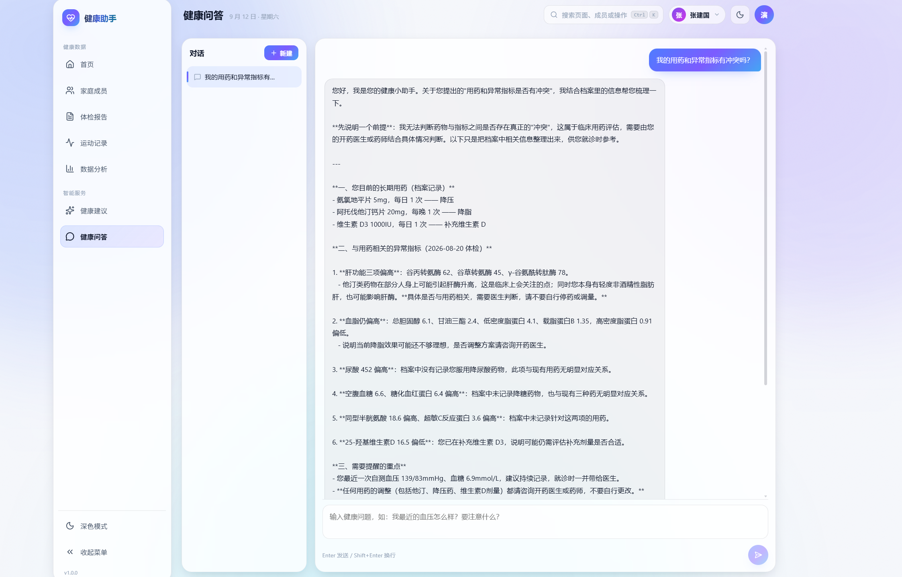
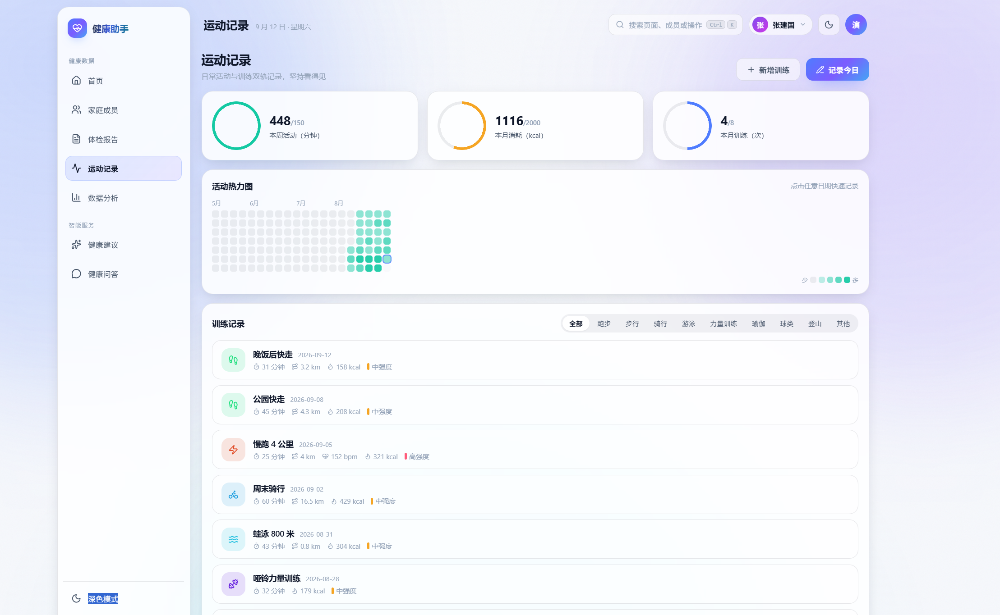
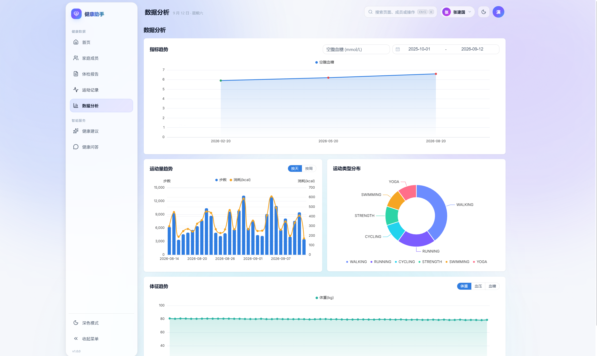

# 智能健康助手（Health Assistant）

一个面向家庭场景的智能健康助手 Web 应用：**一个账号管理全家人的健康档案**，上传体检报告由 AI 自动解析并做"大白话"解读，基于历史数据生成个性化锻炼/康复建议，还能和家人的健康数据对话。

> 个人全栈项目：Java 17 + Spring Boot 3.5 + Vue 3 + Supabase(PostgreSQL/Storage) + DeepSeek。
> 后端约 60 个类、前端 40+ 自研组件、25 张表、71 项体检指标字典、67 个单元测试。

## 界面预览



**健康问答**：SSE 流式回答，自动引用该成员的档案、用药与异常指标



**运动记录**：统计环 + 年度热力图 + 训练卡片流



**数据分析**：指标趋势 / 运动趋势 / 类型分布 / 体征趋势（双主题）

## 功能一览

| 模块 | 能力 |
| --- | --- |
| 多人健康档案 | 单账号管理全家：基础信息、既往病史、过敏史、长期用药、家族史、生活习惯 |
| 体检报告 | 上传电子版 PDF 自动解析（PDFBox + DeepSeek 结构化），也可手动录入/粘贴 |
| 指标字典 | 内置 71 项常用指标（含单位、性别/年龄参考范围、"偏高/偏低"自动判定） |
| AI 大白话解读 | 逐项通俗解释 + 整体风险分级 + 可执行建议，可导出 PDF |
| 个性化建议 | 结合档案/异常指标/近期运动，生成 7 天训练计划与康复建议，可导出 PDF |
| 健康问答 | 多会话、SSE 流式打字机输出，回答自动注入该成员档案、异常指标与运动数据 |
| 运动记录 | 日常活动（步数/睡眠/体重/血压/血糖）+ 训练记录，年度热力图与统计环 |
| 数据图表 | 指标趋势、运动趋势、类型分布、体征趋势（ECharts，双主题） |
| 管理后台 | 用户管理、指标字典维护、Prompt 版本管理、AI 调用日志与费用统计、任务队列 |

## 技术栈

| 层 | 技术 |
| --- | --- |
| 后端 | Java 17 · Spring Boot 3.5 · Spring Security + JWT · MyBatis-Plus · Flyway |
| 数据库 | Supabase PostgreSQL（免费额度 500MB，走 Supavisor Session Pooler） |
| 文件存储 | Supabase Storage（私有桶 + 签名 URL） |
| AI | DeepSeek API（deepseek-chat，OpenAI 兼容格式） |
| PDF | PDFBox（解析）+ Flying Saucer/OpenPDF（生成，中文字体） |
| 前端 | Vue 3 · TypeScript · Vite 6 · Element Plus · ECharts · Pinia |
| 部署 | Docker Compose + Nginx（一键起，含 SSE 透传配置） |

## 项目结构

```
health-assistant/
├── src/main/java/com/health/assistant/
│   ├── client/       DeepSeek 客户端（含 SSE 流式）
│   ├── common/       统一响应、异常、工具
│   ├── config/       安全、MyBatis-Plus、异步任务、存储等配置
│   ├── controller/   REST API
│   ├── service/      业务服务
│   ├── support/      指标匹配、范围判定、Prompt 渲染、文本清洗等
│   ├── task/         异步任务处理器（解析/解读/建议/导出）
│   └── entity/ mapper/ dto/ vo/
├── src/main/resources/
│   ├── db/migration/ Flyway 迁移（V1 建表 + 字典/Prompt 种子）
│   └── templates/pdf PDF 模板
├── frontend/         Vue 3 前端（src/design 设计系统、components 自研组件库）
├── scripts/          演示数据脚本
├── Dockerfile / docker-compose.yml / nginx 配置
└── specplan.md       完整开发计划书（设计与实现细节）
```

---

# 快速开始（保姆级）

只需要 **JDK 17 + Maven + Node 20**，数据库和 AI 都用云服务（免费或几块钱）。

## 第 0 步：装好基础环境（已装可跳过）

| 软件 | 说明 | 验证命令 |
| --- | --- | --- |
| JDK 17 | [Adoptium](https://adoptium.net/) 下载安装 | `java -version` 出现 17 |
| Maven 3.9+ | [下载](https://maven.apache.org/download.cgi) 解压配 PATH，或直接用 IDEA 自带 | `mvn -version` |
| Node.js 20+ | [nodejs.org](https://nodejs.org/) 下载 LTS | `node -v` |

## 第 1 步：注册 Supabase（数据库 + 文件存储，免费）

1. 打开 https://supabase.com 注册/登录，点 **New project**
   - Name 随便填（如 `health-assistant`）
   - **Database Password**：点 Generate 生成后**复制保存**（后面要用）
   - Region 选离你近的（如 Singapore / Mumbai）
2. **建两个私有存储桶**：左侧 `Storage` → `New bucket`
   - 建 `health-reports`（不要勾 Public）
   - 建 `health-exports`（不要勾 Public）
3. **拿三个凭证**（后面填 `.env` 用）：
   - 连接串：点项目页顶部绿色 **Connect** 按钮 → 选 **Session pooler** 标签 → 复制 `postgresql://...` 那串
     - 注意：不是 Direct connection，也不是 Transaction pooler
   - Project URL：`Project Settings` → `API` → Project URL（形如 `https://xxxx.supabase.co`）
   - service_role：同页面 service_role secret（点 Reveal 显示；**只放服务端，切勿外泄**）
4. **创建应用专用数据库角色**（不要直接用 postgres 密码）：左侧 `SQL Editor`，新建查询，执行：
   ```sql
   CREATE ROLE health_app LOGIN PASSWORD '换成你自己的密码';
   GRANT CONNECT ON DATABASE postgres TO health_app;
   GRANT USAGE, CREATE ON SCHEMA public TO health_app;
   ALTER ROLE health_app SET search_path = public;
   ```
   把 `换成你自己的密码` 替换成一个随机密码（这个密码也是填进 `.env` 的）。

## 第 2 步：注册 DeepSeek（AI 能力，按量付费）

1. 打开 https://platform.deepseek.com 注册/登录
2. 左侧 **API Keys** → 创建 API key（`sk-` 开头，复制保存）
3. 充值：**¥10 就够开发体验很久**（单次解读约几分钱）。余额不足时 AI 接口会明确报错

> 只想看界面、不测 AI 也可以先跳过，后面随时把 key 填进 `.env` 重启即可。

## 第 3 步：配置 .env

在项目根目录：

```bash
cp .env.example .env
```

用编辑器打开 `.env`，按下表逐项填写（每一项从哪来都写清楚了）：

| 变量 | 从哪来 |
| --- | --- |
| `SUPABASE_DB_URL` | Session pooler 连接串改成 JDBC 格式：把 `postgresql://` 换成 `jdbc:postgresql://`，去掉 `用户名:密码@`，末尾加 `?sslmode=require`。例：`jdbc:postgresql://aws-0-ap-southeast-1.pooler.supabase.com:5432/postgres?sslmode=require` |
| `SUPABASE_DB_USER` | 连接串里 `@` 前面那段，形如 `health_app.<项目ref>`（如果沿用 postgres 账号就是 `postgres.<项目ref>`） |
| `SUPABASE_DB_PASSWORD` | 第 1 步创建 health_app 角色时设置的密码 |
| `SUPABASE_URL` | 第 1 步的 Project URL |
| `SUPABASE_SERVICE_ROLE_KEY` | 第 1 步的 service_role secret |
| `DEEPSEEK_API_KEY` | 第 2 步创建的 key |
| `JWT_SECRET` | 随便一串 32 位以上的随机字符 |
| `AI_DAILY_LIMIT_PER_USER` | 每人每天 AI 次数上限，默认 3，小圈子防超支 |
| `MAX_USERS` | 注册总人数上限，默认 10，`0` 表示不限 |

> 项目读取 `.env` 后会自动建表（Flyway 迁移 V1~V5），无需手动执行建表 SQL。

## 第 4 步：启动（开两个终端）

```bash
# 终端 1：后端（项目根目录）
mvn spring-boot:run
# 看到 Started HealthAssistantApplication 即成功

# 终端 2：前端（frontend 目录）
cd frontend
npm install     # 首次需要，约 1-2 分钟
npm run dev
# 看到 Local: http://localhost:5173/ 即成功
```

浏览器打开 **http://localhost:5173**：
1. 点"立即注册"注册一个账号（或直接用管理员账号，见下）
2. 首页 → 右上角成员切换器 → 新增成员
3. 体检报告 → 上传电子版 PDF（扫描件暂不支持）→ 10 秒左右自动解析
4. 报告详情 → 生成 AI 解读 / 生成锻炼建议 / 健康问答

**默认管理员**：首次启动自动创建 `admin / admin123456`（可用 `ADMIN_DEFAULT_PASSWORD` 修改），登录后请立即改密码。

## 第 5 步（可选）：一键灌入演示数据

想快速看"数据全满"的效果，运行仓库里的脚本（需要后端已启动）：

```powershell
powershell -ExecutionPolicy Bypass -File scripts/seed-demo-data.ps1
```

会创建演示账号 **demo / demo123456**：一位成员的完整档案 + 3 次体检（每次 71 项指标，含恶化趋势）+ 60 天运动 + 18 条训练记录。脚本可重复执行，不会重复灌。

## 第 6 步（可选）：Docker 一键部署

```bash
# 1. 准备中文字体（PDF 导出用，Windows 上执行）
mkdir fonts
copy C:\Windows\Fonts\simhei.ttf fonts\simhei.ttf

# 2. 构建并启动（前端 + 后端两个容器）
docker compose up -d --build

# 3. 访问 http://服务器IP/
```

数据库和存储仍在 Supabase 云端，容器只跑应用。Nginx 已配好 SSE 透传（流式对话可用）。

---

# 常见问题（FAQ）

**Q1：启动报错 `Connection refused` / 连不上数据库？**
检查 `.env` 的 `SUPABASE_DB_URL` 是否是 Session pooler 的地址（含 `pooler.supabase.com`），`sslmode=require` 是否带上；确认第 1 步的建角色 SQL 已执行。

**Q2：上传报告后一直"解析中"？**
解析调用 DeepSeek 需要网络。若失败，报告会变红"解析失败"，点"重解析"重试；也可用"手动录入"。

**Q3：扫描版/拍照的 PDF 能解析吗？**
一期只支持电子版 PDF（能选中文字的那种）。扫描件会提示"需手动录入"。

**Q4：导出 PDF 报错"中文字体不存在"？**
检查 `app.export.font-path`（默认 `C:/Windows/Fonts/simhei.ttf`）。没有该字体时，从任意中文字体复制一个 TTF 并配置路径即可。

**Q5：AI 报"AI 服务繁忙/余额不足"？**
去 platform.deepseek.com 看余额；受限时应用会按 `AI_DAILY_LIMIT_PER_USER` 限流，第二天自动恢复。

**Q6：Supabase 免费项目会休眠吗？**
免费项目 7 天无请求会暂停，去 Dashboard 点 Restore 即可；日常使用不会触发。可用 UptimeRobot 每 3 天 ping 一次保活。

**Q7：前端端口 5173 被占用？**
改 `frontend/vite.config.ts` 的 `server.port`，或关掉占用进程。

**Q8：能不能给手机/其他人用？**
可以。局域网：手机连同一 WiFi 访问 `http://电脑IP:5173`（Vite 已开 host）。公网：用 `docker compose` 部署到一台云服务器即可；或开发期用 Cloudflare Tunnel 临时暴露（电脑需保持开机）。

---

# 安全与隐私提示

- `.env` 含数据库密码、Supabase service_role、DeepSeek key，**已被 .gitignore 排除，切勿提交**
- 健康数据敏感：生产环境请修改默认管理员密码与 `JWT_SECRET`，并为 Supabase 项目开启强密码
- AI 输出仅为健康管理参考，**不构成医疗诊断**；应用内已附免责声明

# License

[MIT](LICENSE) © 2026 sqyCoder
